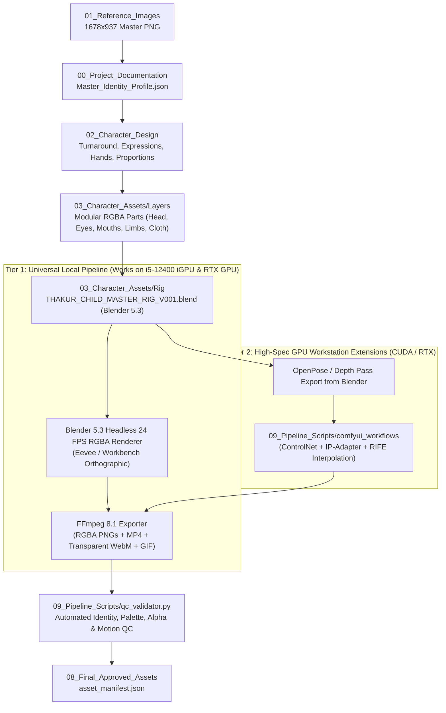

# VISUAL STYLE GUIDE & MULTI-MACHINE TOOLCHAIN ARCHITECTURE
## Project: Pram Bismoy Balak Thakur (প্রম বিস্ময় বালক ঠাকুর)

---

## 1. ARTISTIC DIRECTION — BENGALI ANIMATED STORYBOOK AESTHETIC

### Visual Pillars
1. **Hand-Painted Warmth:** Inspired by classic 2D hand-painted cel and watercolor animation (Studio Ghibli's organic warmth combined with authentic rural Bengal heritage).
2. **Restrained Sepia-Charcoal Linework:** Character outlines use warm dark umber (`#4A3121` to `#533E2D`) with subtle calligraphic taper (1.5 px – 3.0 px at 1080p), avoiding heavy black comic-book ink or harsh vector uniform strokes.
3. **Two-Tone Soft Cel Shading + Rim Light:**
   - Characters use a clean base fill, one primary shadow plane with soft anti-aliased transitions, a deep crease shadow for overlapping cloth folds, and an optional warm sunlight rim highlight (`#FEFABD`).
4. **Authentic Rural Bengal Atmosphere (Ujanchar):**
   - Bamboo structural posts, woven reed mats (*pati*), thatched verandas, banana leaves, mango groves, and dappled golden morning light.
5. **Natural, Believable Motion:**
   - Every movement obeys the 12 principles of animation at **24 FPS**: subtle breathing anticipation, secondary cloth follow-through on the *uttoriyo*, and gentle ease-in/ease-out.

---

## 2. DUAL-TIER MULTI-MACHINE PRODUCTION ARCHITECTURE

Because you work on this repository across **two machine configurations**—this **Intel i5-12400 (16 GB RAM, Intel UHD 730 iGPU) workstation** AND a **higher-spec GPU workstation (e.g., Ryzen 7 3700X / RTX 2060+ CUDA)**—our repository is architected to run seamlessly on both without breaking paths or requiring manual reconfiguration:

### Portable Design Rules for Multi-Machine Git Sync
1. **Relative Paths in All Scripts & `.blend` Files:** All textures inside `THAKUR_CHILD_MASTER_RIG_V001.blend` use Blender relative paths (`//../Layers/...`) and Python scripts resolve from `Path(__file__).resolve().parent.parent`.
2. **Hardware Auto-Detection in Python & Blender Scripts:**
   - Our Blender rendering scripts automatically detect if `CUDA` or `OPTIX` is available (`bpy.context.preferences.addons['cycles'].preferences`). On the RTX machine, it enables GPU acceleration automatically; on the i5-12400 machine, it uses fast 2D Orthographic Eevee/Workbench rendering (which renders 24 FPS sequences in <10 seconds even on integrated graphics).
3. **Ready-to-Run ComfyUI Workflows Included:**
   - In `09_Pipeline_Scripts/comfyui_workflows/`, we include portable ComfyUI API/workflow templates (`thakur_controlnet_ipadapter_workflow.json`) configured for 6 GB+ VRAM (FP16 / tiled VAE) so that when you open the repo on your higher-spec GPU machine, you can immediately run local ControlNet/IP-Adapter passes guided by our Blender rig's OpenPose/Depth outputs.
